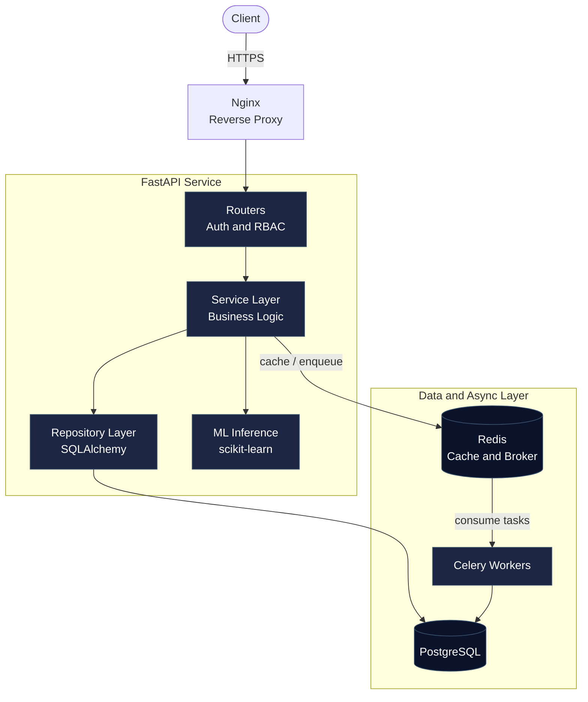
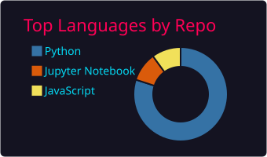
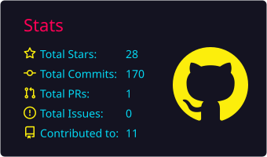
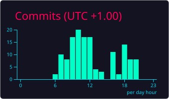

<h3 align="center">Backend Developer + AI</h3>

  

  
  
  
  

---

## 👩‍💻 About Me

Backend Developer focused on **Python** and **FastAPI**, building **production-ready** APIs and **scalable** server-side systems. My core work is designing RESTful APIs, implementing authentication and RBAC, managing asynchronous workflows with **Celery**, and working with **PostgreSQL**, **Redis** and **Docker**, with an emphasis on clean architecture and maintainable code.

Alongside backend development I work with **Django** and **Machine Learning**. I build **intelligent backend systems** with FastAPI and ML, where **ML systems** are trained, served and integrated as reliable backend services.

🎓 Computer Engineering student at **Lorestan University**

> I believe in learning by building, breaking things, and fixing them better than before ✨

---

## 🎯 Focus Areas

| | Area | Details |
|---|---|---|
| 🐍 | **Python Backend Development** | Clean, maintainable Python with layered architecture and clear separation of concerns |
| ⚡ | **FastAPI & REST APIs** | Typed, validated, well-documented APIs with authentication and role-based access control |
| 🗄️ | **Databases** | Relational schema design, SQL, migrations and query work with PostgreSQL and SQLite |
| 🚀 | **Async, Caching & Deployment** | Celery background tasks, Redis caching, Docker containers behind Nginx on Linux |
| 🌿 | **Django** | Web applications and APIs with Django |
| 🤖 | **Machine Learning** | Data analysis, model training and evaluation with the Python data stack |

---

## 🏗️ Backend Architecture

Containerized with Docker · Served behind Nginx

---

## 🛠️ Tech Stack

<h4 align="center">Languages</h4>

  
  
  
  

<h4 align="center">Backend & API Development</h4>

  
  
  
  
  

<h4 align="center">Databases & Data Layer</h4>

  
  
  
  
  

<h4 align="center">Async Processing & Caching</h4>

  
  
  

<h4 align="center">Architecture & Engineering Concepts</h4>

  
  
  
  

<h4 align="center">DevOps & Deployment</h4>

  
  
  

<h4 align="center">AI & Machine Learning</h4>

  
  
  
  

<h4 align="center">Tools & Workflow</h4>

  
  
  
  
  

---

## 🚀 Currently Focused On

- ⚡ Deepening my FastAPI skills: project structure, testing and deployment
- 🌿 Building more with Django
- 🤖 Applying Machine Learning in backend projects

<!--
## 📌 Featured Projects
- **[project-name](https://github.com/ISanaSaki/project-name)**: one line on what it does, the stack (FastAPI, PostgreSQL, Redis, Docker) and the key result.
-->

---

## 📊 GitHub Stats

  

  
  

  
  

---

## 📈 Contributions

  

  <picture>
    <source media="(prefers-color-scheme: dark)" srcset="https://raw.githubusercontent.com/iSanaSaki/iSanaSaki/output/github-contribution-grid-snake-dark.svg">
    <source media="(prefers-color-scheme: light)" srcset="https://raw.githubusercontent.com/iSanaSaki/iSanaSaki/output/github-contribution-grid-snake.svg">
    
  </picture>

---

## 📫 Let's Connect

  
  
  

